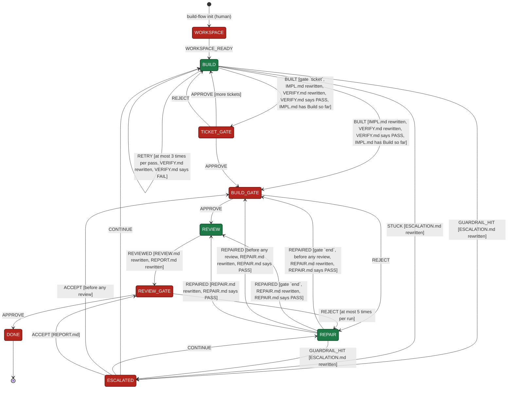

# build-flow: logical diagram

The state machine in `flow.definition.mjs`, drawn as a diagram. Boxes are states, arrows are events (the `<EVENT>` of `build-flow send`), and the text in brackets is the route condition and what must hold before the event. The diagram is generated from the definition between the markers: edit the definition, then run `node docs.mjs --write`.

<!-- generated from flow.definition.mjs by docs.mjs: edit the definition, then run node docs.mjs --write -->

<!-- end generated -->

## Legend

| Colour | Actor | Who sends the event |
|---|---|---|
| Green | agents: subagents implement, verify, review | the orchestrator, once they return and it has written their result |
| Red | human: a gate | the orchestrator, with the human's verdict as `--note`, and only once the human accepts the permission prompt |

## Reading the loops

- **WORKSPACE** runs once, when the run is created: the human picks a new worktree or confirms a branch of the repo, and gives the ticket id every commit message of the run carries (with none, each commit takes one word for the area of its own ticket, from that ticket's file); the engine checks the workspace before the first ticket. Nothing leads back to it, so resuming a run never repeats it.
- **The ticket loop** runs BUILD once per ticket in queue order. Inside BUILD the orchestrator loops implement → verify → fix until `VERIFY.md` says PASS. Each FAIL is a RETRY, at most 3 per pass; past that RETRY is refused and the only way on is STUCK. A new ticket, a REJECT or a CONTINUE starts a new pass. With `--gate ticket` every ticket stops at TICKET_GATE; with `--gate end` the engine records the ticket on BUILT and moves on, and the human sees the whole build at BUILD_GATE.
- **REJECT at TICKET_GATE** sends the same ticket back to BUILD; IMPL.md and VERIFY.md have to be rewritten before BUILT.
- **The review loop**: every review stops at REVIEW_GATE, where the human reads REPORT.md and chooses. REJECT with the findings to fix (or other improvements) goes REVIEW_GATE → REPAIR → REVIEW → REVIEW_GATE, at most 5 times; past that REJECT is refused. APPROVE closes the run.
- **Commits in commit mode ticket**: with `--gate ticket` the human commits each ticket themselves, after its APPROVE, with the message the next state suggests; with `--gate end` the engine commits it on BUILT, with a message that follows references/commit-msg.md. Repairs follow the same rule: with `--gate ticket` the gate after a repair suggests its message and the human commits it; with `--gate end` the engine commits it on REPAIRED. In commit mode none nothing is committed, and BUILD_GATE proposes one message for the whole build.
- **A guardrail finding** (the fix needs a secret or a `.env` file) isn't fixed: REPAIR escalates it at once, and the human CONTINUEs with how to change it or ACCEPTs the build without it.
- **REJECT at BUILD_GATE** goes to REPAIR and back to BUILD_GATE, so the human still writes the review brief before the first review. It doesn't use a repair round.
- **ACCEPT is refused for a BUILD escalation**: tickets are left to build, so the only way on is CONTINUE.
- **To stop a run**, leave it where it is: nothing needs closing.
