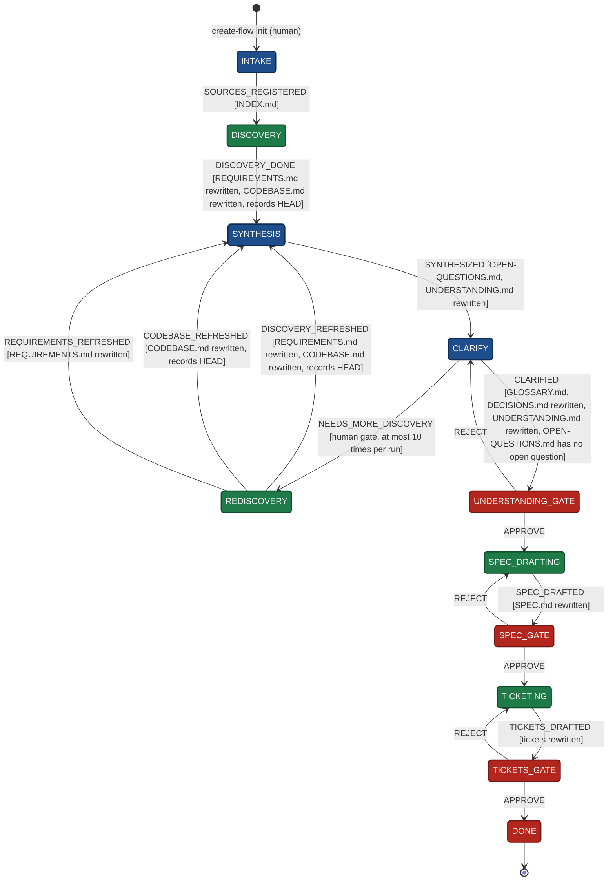

# create-flow: logical diagram

The state machine in `flow.definition.mjs`, drawn as a diagram. Boxes are states, arrows are events (the `<EVENT>` of `create-flow send`), and the text in brackets is what has to be true before the event is ready. `flow.definition.mjs` is the source of truth. The diagram is generated from it: after changing the definition, run `node docs.mjs --write` (the tests fail until you do).

<!-- generated from flow.definition.mjs by docs.mjs: edit the definition, then run node docs.mjs --write -->

<!-- end generated -->

## Legend

| Colour | Actor | Who sends the event |
|---|---|---|
| Blue | orchestrator: works with the human in the main session | the orchestrator |
| Green | agents: subagents write the reports, spec or tickets | the orchestrator, once they return |
| Red | human: a gate | the orchestrator, with the human's verdict as `--note`, and only once the human accepts the permission prompt |

## Reading the loops

- **REJECT** sends the run back one step to the state that produced the work, with the human's note. The work has to be rewritten there before the event can be sent again.
- **NEEDS_MORE_DISCOVERY** goes from CLARIFY to REDISCOVERY when an answer needs evidence the reports don't have, and only once the human accepts the permission prompt. Only the report the open questions need is rewritten, and the event sent from REDISCOVERY says which: both, the code report or the requirements report. After 10 rounds in a run the engine refuses it, so the remaining questions are answered or deferred with the human.
